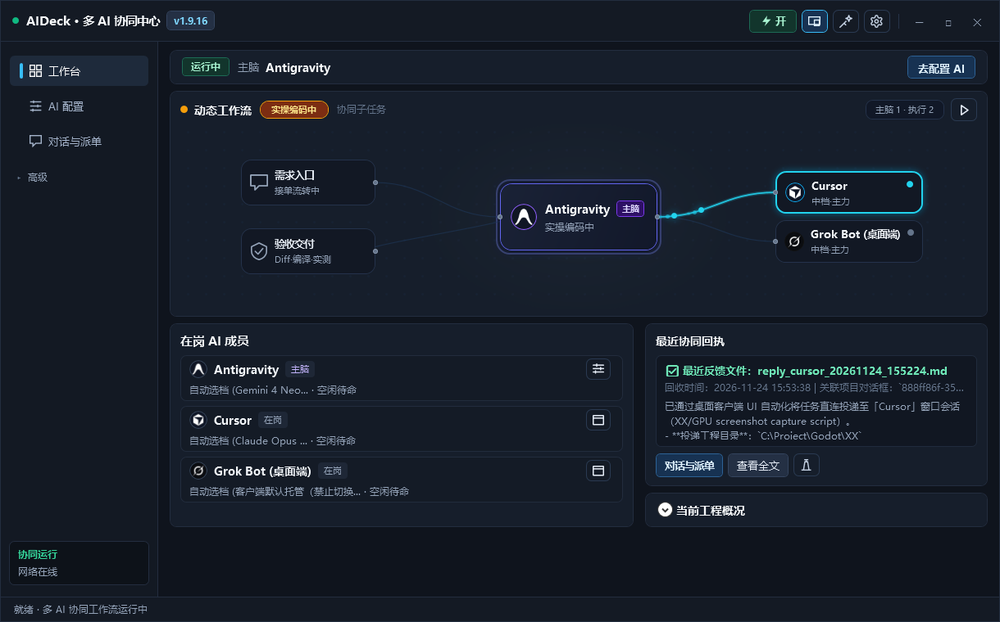
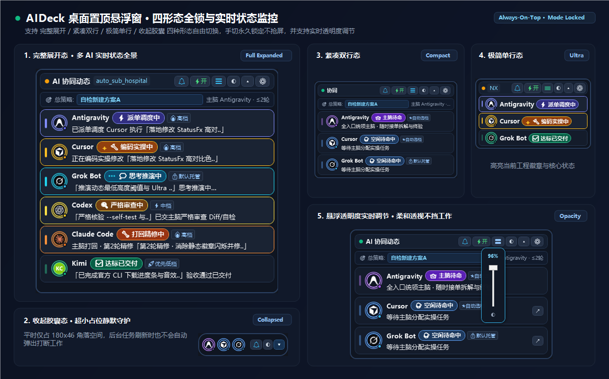
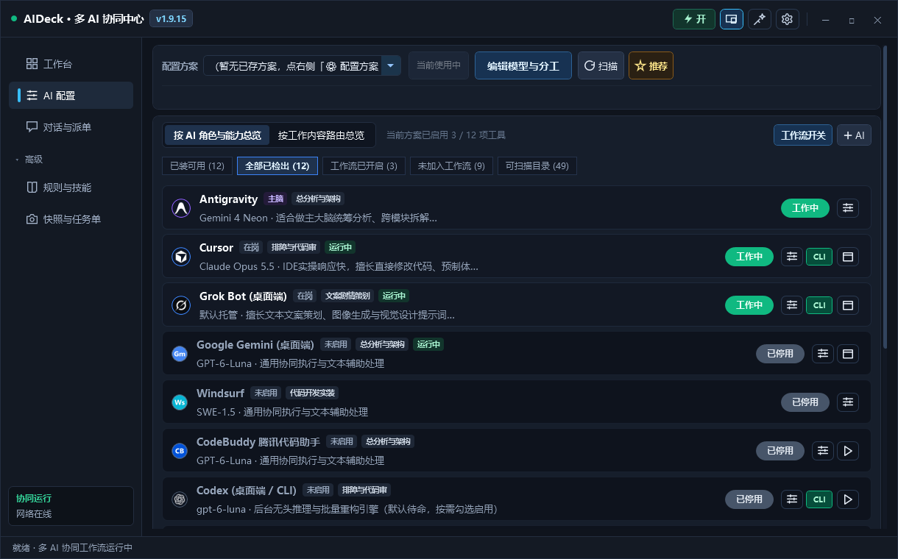
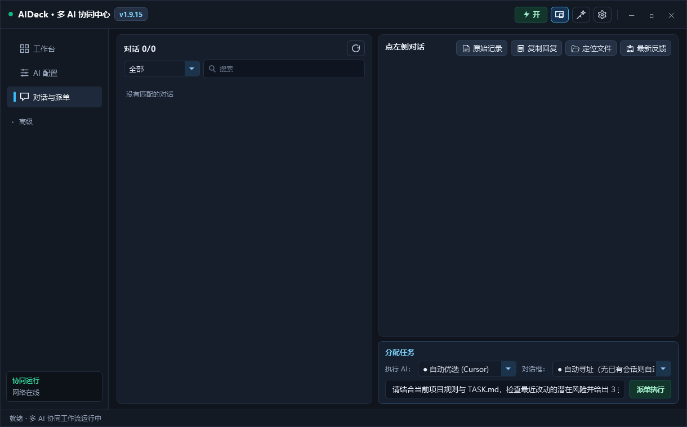
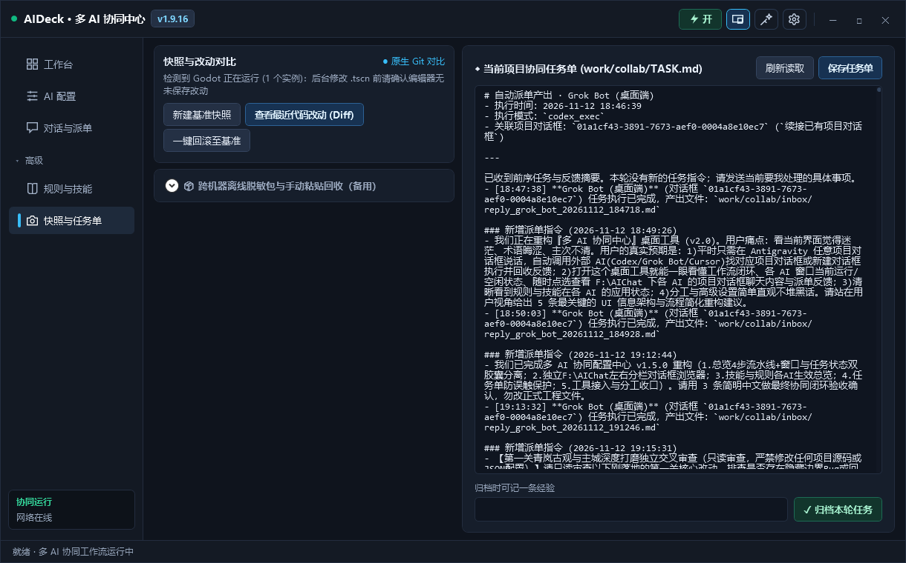
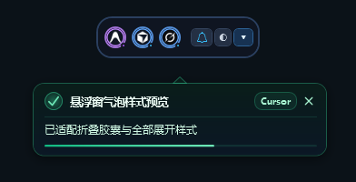
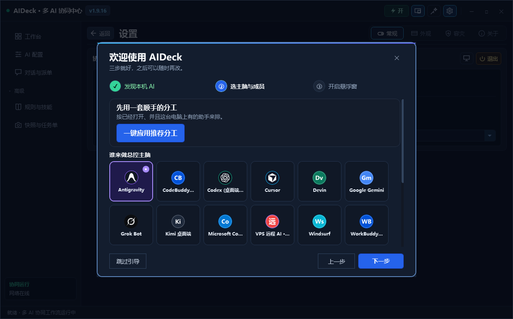
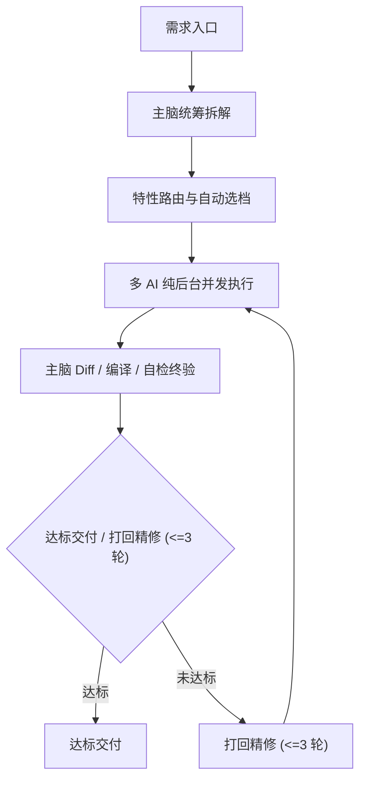

<div align="center">


<h1>AIDeck · 多 AI 协同中心</h1>

<p>面向 Windows 多工程开发的多 AI 协同调度、特性路由与桌面悬浮监控中心（.NET 8 + WPF 单文件绿色发布）</p>

<p>
  <a href="https://github.com/tianmenglele/ai-deck/releases"></a>
  
  
  
  <a href="LICENSE"></a>
</p>

<p>
  <strong>⬇ <a href="https://github.com/tianmenglele/ai-deck/releases/latest">直接下载开箱即用版</a></strong>
  · 独立免装单文件
  <code>AIDeck-v1.9.17-win-x64.exe</code>
  · 绿色便携包
  <code>AIDeck-v1.9.17-win-x64-portable.zip</code>
</p>

<p>
  <a href="#核心特性">核心特性</a>
  ·
  <a href="#实机预览">实机预览</a>
  ·
  <a href="#协同架构">协同架构</a>
  ·
  <a href="#快速开始">快速开始</a>
  ·
  <a href="#开放扩展">开放扩展</a>
  ·
  <a href="#借鉴学习与开源致谢">借鉴与致谢</a>
  ·
  <a href="#致谢与协议">致谢与协议</a>
</p>

</div>

<a id="核心特性"></a>

## 核心特性

当前版本 **v1.9.17**。AIDeck 专为同时使用多个桌面/终端 AI 编程助手的 Windows 开发者打造，核心解决多 AI 协作中最常见的 6 大痛点：

| 开发痛点 | AIDeck 如何解决 |
| --- | --- |
| 多 AI 各干各的，反复复制粘贴需求与手动验收 | 主脑自动拆解需求、按专长与高/中/低模型档位派单给多个 AI 并发实操；改完自动核验 Diff、编译与自检，不达标打回原会话精修（最多 3 轮）。 |
| 后台调度老抢焦点切屏，或降级成看不见的无头 CLI | 全程纯后台静默调度，不抢键鼠、不打断当前打字；所有执行均保留在各 AI 原生桌面窗口会话里，随时点进去查看过程或接管。 |
| 多个 AI / 多任务并行时，看不清谁在忙、干了几件事 | 桌面置顶悬浮窗（折叠胶囊 / 极简单行 / 紧凑双行 / 完整展开，手切永久锁定不抢屏）毫秒～秒级同步状态；同一 AI 并行多项任务时右上角直接显示数量角标（`2`/`3`/`9+`），完工时在角落弹出不打扰的磨砂完成气泡。 |
| 每个 AI 都要单独维护规则、技能和踩坑经验 | 单一事实源零拷贝同步：项目里只维护一份规则、技能与经验库真身，勾选启用哪个 AI 就自动同步给谁，停用即自动剥离不留残留。 |
| AI 改坏代码难回退，多项目并行容易串台 | 每次派单前自动建立代码快照基准，支持差异对比与一键回滚；状态与任务回执按工程隔离，同时开多个项目互不串扰。 |
| 换机配置太繁琐，单文件放桌面缺配置跑不起来 | 单文件开箱即用：内置全部探测规则、挂载模板与启动脚本，双击即通过 3 步新手向导完成自动扫描与分工；内置官方更新源，启动自动静默检测新版本一键升级。 |

<a id="实机预览"></a>

## 实机预览

### 1. 协同工作台

五步动态工作流运行图、在岗 AI 成员与最新协同回执总览。



### 2. 桌面置顶悬浮窗（四形态全锁与实时状态监控）

支持完整展开 / 紧凑双行 / 极简单行 / 收起胶囊四态，以及手切永久锁定与实时透明度调节；各 AI 工作阶段毫秒～秒级同步，不抢前台焦点。



### 3. AI 阵容与特性路由

多 AI 工具自动探测、模型档位配置与能力星级路由矩阵。



### 4. 规则与技能单一事实源

共享技能、项目规则与经验库多工具生效状态及实时预览。


### 5. 跨工具对话与自动派单

统一管理各 AI 历史会话、指令/回复气泡与智能派单入口。



### 6. 代码快照保护与协同任务单

改动 Diff 快照基准、一键回滚与协同任务活卡管理。



### 7. 磨砂完成气泡通知与自定义留屏时长

折叠胶囊完成时弹出磨砂气泡：标题与正文分离，悬停暂停，留屏时长可在 4 到 30 秒之间设置。



### 8. 3 步首次使用新手向导

首次打开按 3 步引导完成上手，之后也可从顶栏再次进入。



<a id="协同架构"></a>

## 协同架构

需求从入口进入主脑。主脑拆解后按特性选档，多个 AI 在后台并发执行。终验看 Diff、编译和自检：达标即交付，未达标则打回精修，最多 3 轮后回到执行。



<a id="快速开始"></a>

## 快速开始

### 直接下载开箱即用版（推荐普通用户）

无需克隆仓库、不必本机安装 .NET SDK。打开最新 Release 页即可下载：

**[https://github.com/tianmenglele/ai-deck/releases/latest](https://github.com/tianmenglele/ai-deck/releases/latest)**

| 资源 | 说明 |
| --- | --- |
| `AIDeck-v1.9.17-win-x64.exe` | **独立免装运行时单文件版**（自包含 .NET 8，双击即可运行） |
| `AIDeck-v1.9.17-win-x64-portable.zip` | **绿色便携压缩包**（含主程序、`registry/`、`plugins/`、启动脚本与说明） |
| `AIDeck-v1.9.17-win-x64-lite.zip` | 轻量版（需本机已安装 [.NET 8 桌面运行时](https://dotnet.microsoft.com/download/dotnet/8.0)） |
| `SHA256SUMS.txt` | 上述产物的 SHA256 校验清单 |

下载后建议对照 `SHA256SUMS.txt` 校验完整性，再启动 `AI协同中心.exe`（便携包内）或直接运行独立单文件 `AIDeck-v1.9.17-win-x64.exe`。

### 从源码编译（开发者）

环境：Windows 10/11 x64，以及 [.NET 8 SDK](https://dotnet.microsoft.com/download/dotnet/8.0)。

```powershell
git clone https://github.com/tianmenglele/ai-deck.git
cd ai-deck
```

Release 编译：

```powershell
dotnet build src/AICollabHub.csproj -c Release --nologo
```

单文件发布到 `outputs/v1.9.17/AI协同中心`（依赖本机 .NET 8 桌面运行时，不带安装向导）：

```powershell
dotnet publish src/AICollabHub.csproj -c Release -r win-x64 --self-contained false -p:PublishSingleFile=true -p:DebugType=portable -p:DebugSymbols=true -o outputs/v1.9.17/AI协同中心 --nologo
```

全量离线自检 **383/383 PASS**。v1.9.17 在既有基线上新增新手向导启用 AI 过滤、原生圆角无缝边框与中文换行悬停卡片硬门限。命令不改写正在使用的程序，报告写到 `work/self_test_out`（该目录已被 `.gitignore` 忽略）：

```powershell
.\outputs\v1.9.17\AI协同中心\AI协同中心.exe --self-test .\work\self_test_out
```

启动：双击发布目录中的 `AI协同中心.exe`，或：

```powershell
powershell -NoProfile -ExecutionPolicy Bypass -File .\启动协同中心.ps1
```

### 软件内自主检查更新

从 **v1.9.17** 起已内置默认官方仓库地址 `https://github.com/tianmenglele/ai-deck`，检查目标对应 [Releases](https://github.com/tianmenglele/ai-deck/releases)。无需手动填写更新源。默认在启动 4 秒后自动后台检查；顶栏版本按钮显示当前 `v1.9.17`。发现新版本时在顶栏展示提示，并支持一键下载、替换后重启。同一时刻只允许一路检查进入，占用中的重复触发会被防重入锁拒绝，结束后才能再次检查。

<a id="开放扩展"></a>

## 开放扩展

注册表与插件都是明文，改完即被运行时读取，不必改 `src/` 才能接入新工具或新流程。

| 扩展口 | 路径 | 用途 |
| --- | --- | --- |
| 工具探测 | `registry/detectors.json` | 本机与桥接工具的路径、进程、命令和默认能力 |
| 挂载适配 | `registry/adapters.json` | 规则与技能写到各工具原生目录的方式 |
| 能力标签 | `registry/capability_tags.json` | 特性路由使用的能力维度 |
| 工作流模板 | `registry/workflows.json` | 分档协同阶段与交付物 |
| 工程预设 | `registry/project_presets.json` | 快照扩展名、排除目录、工程类型差异 |
| 脚本钩子 | `plugins/*.ps1` | 明文脚本扩展；现有 `export_config_digest.ps1` 用于导出配置结构速查 |

### 目录结构

```text
ai-deck/
├── .github/
│   └── workflows/
│       └── release.yml
├── docs/
│   └── images/
│       ├── banner.png
│       ├── 01-workbench.png
│       ├── 02-roster-routing.png
│       ├── 03-rules-skills.png
│       ├── 04-dialogs-dispatch.png
│       ├── 05-snapshots-task.png
│       ├── 06-floating-hud.png
│       ├── 07-completion-bubble.png
│       └── 08-onboarding-wizard.png
├── plugins/
│   └── export_config_digest.ps1
├── registry/
│   ├── adapters.json
│   ├── capability_tags.json
│   ├── detectors.json
│   ├── project_presets.json
│   └── workflows.json
├── src/
│   ├── Assets/
│   │   ├── icons/
│   │   ├── Sounds/
│   │   │   └── CREDITS.md
│   │   └── app_icon.ico
│   ├── Models/
│   ├── Services/
│   ├── UI/
│   ├── AICollabHub.csproj
│   ├── app.manifest
│   └── Program.cs
├── .gitattributes
├── .gitignore
├── AGENTS.md
├── LICENSE
├── README.md
└── 启动协同中心.ps1
```

`outputs/`、`work/`、编译中间目录和本机自动生成的 `.agents/`、`.cursor/` 不进入版本库。

### 个人数据

花名册、更新源、窗口形态和项目记录写在 `%LOCALAPPDATA%\AICollabHub`，与仓库目录分开。绿色分享包不携带这份个人数据。

<a id="借鉴学习与开源致谢"></a>

## 借鉴学习与开源致谢

AIDeck 站在诸多优秀开源项目与开发者生态之上。以下仓库与社区对本项目的架构思路、数据源与工具链有直接启发或对接价值，在此致以诚挚感谢（仓库地址均为真实公开仓库，按字母/相关度罗列）：

- **[nrslib/takt](https://github.com/nrslib/takt)**（TAKT Agent Koordination Topology）：借鉴其多 Agent 声明式分工编排、审查与打回精修闭环防无限空转、以及外部工作节点桥接理念（软件内置 `takt_vps_bridge` 桥接支持）。
- **[BerriAI/litellm](https://github.com/BerriAI/litellm)**：感谢 LiteLLM 开源社区维护的公开模型规格与上下文窗口清单（用于云端模型能力推荐数据源之一）。
- **[openai/codex](https://github.com/openai/codex)** 与 **[anthropics/claude-code](https://github.com/anthropics/claude-code)**：感谢 OpenAI Codex CLI 与 Claude Code CLI 团队打造的多 Agent 终端工具生态，AIDeck 原生支持其状态探测、版本检查与规则挂载。
- **[ollama/ollama](https://github.com/ollama/ollama)**：感谢 Ollama 本地开源大模型运行时社区，AIDeck 开箱支持本地 OpenAI 兼容服务探测。
- **[dotnet/wpf](https://github.com/dotnet/wpf)**：感谢 .NET 8 与 WPF 开源社区提供稳定的 Windows 桌面端单文件发布与 UI Automation 底层能力。
- **[yetone/magpie](https://github.com/yetone/magpie)**：感谢其中心拓扑脑图视觉设计思路的启发。

同时感谢 **OpenRouter**、**Cursor**、**Antigravity**、**Grok Bot**、**LM Studio**、**Windsurf** 等开发者生态，以及公开分享 `AGENTS.md` / `.cursor/rules` / `.cursor/skills` 规范的开源贡献者。

<a id="致谢与协议"></a>

## 致谢与协议

5 路内嵌提示音为 DOLLARS 风格电钢柔和乐句，格式 44100 Hz / 16-bit PCM，按 **CC0-1.0** 分发。曲目、时长与触发场景见 [src/Assets/Sounds/CREDITS.md](src/Assets/Sounds/CREDITS.md)。

本仓库以 [MIT License](LICENSE) 授权，版权声明为 `Copyright (c) 2026 tianmenglele`。
