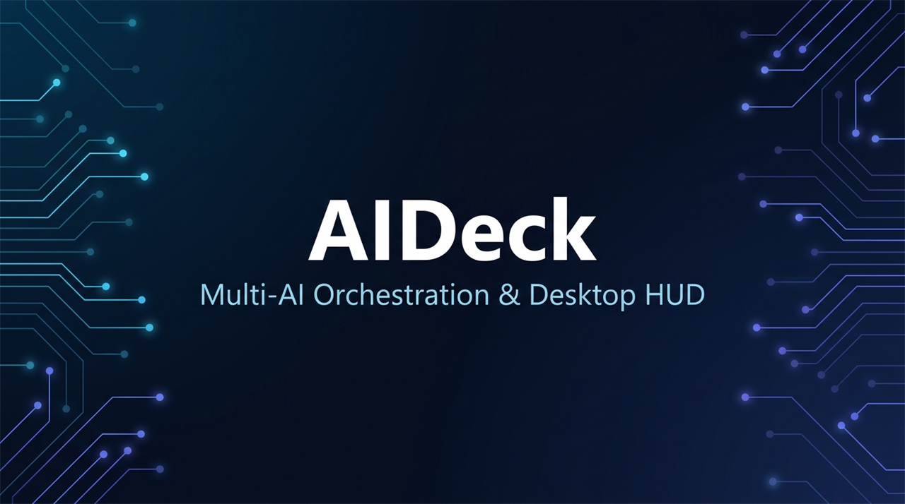
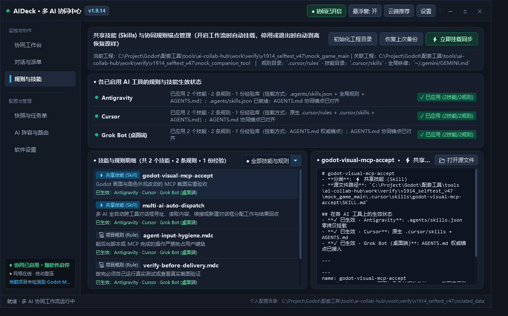
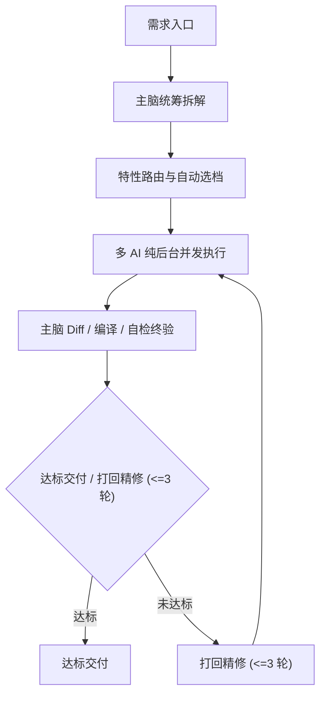

<div align="center">



<h1>AIDeck · 多 AI 协同中心</h1>

<p>面向 Windows 多工程开发的多 AI 协同调度、特性路由与桌面悬浮监控中心（.NET 8 + WPF 单文件绿色发布）</p>

<p>
  <a href="https://github.com/tianmenglele/ai-deck/releases"></a>
  
  
  
  <a href="LICENSE"></a>
</p>

<p>
  <a href="#核心特性">核心特性</a>
  ·
  <a href="#实机预览">实机预览</a>
  ·
  <a href="#协同架构">协同架构</a>
  ·
  <a href="#快速开始">快速开始</a>
  ·
  <a href="#开放扩展">开放扩展</a>
  ·
  <a href="#致谢与协议">致谢与协议</a>
</p>

</div>

<a id="核心特性"></a>

## 核心特性

当前版本 **v1.9.14**。主脑负责拆解、派单与终验；执行端留在各自桌面会话里完成后台改动，悬浮窗只同步状态，不抢当前焦点。

| 模块 | 说明 |
| --- | --- |
| 主脑统筹与严格验收闭环 | Antigravity 主脑完成分析、派单，以及 Diff、编译与 `--self-test` 终验。不达标自动打回同一会话重修，最多 3 轮。 |
| 全 AI（含 Grok Bot）纯后台零抢前台 | `StrictNoForegroundStealOnDispatch = true`，`AllowHeadlessCliFallbackForDesktopAgents = false`。进程内轻量 UIA 与键鼠静默门控，桌面工具不降级到看不见的无头 CLI，也不打断当前输入。 |
| 桌面置顶悬浮窗全形态锁定 | 折叠胶囊、极简单行、紧凑双行、完整展开。手动切换后永久锁定，任务开始、完成或异常刷新都不会自动弹出抢屏。 |
| 毫秒/秒级实时状态同步与跨工程防串扰 | 主界面与悬浮窗按毫秒级探测、秒级刷新各 AI 阶段；回执按工程隔离，不串到其他项目。 |
| 飞行任务单显示具体任务名 | 跨工具派单动画胶囊实时展示提炼后的任务标题，而不是笼统的「处理中」。 |
| 版本号展示与自主检查更新 | 顶栏版本按钮显示 `v1.9.14`。启动后可对 [Releases](https://github.com/tianmenglele/ai-deck/releases) 做后台静默检查，检查动作带防重入锁。 |
| DOLLARS 风格电钢柔和提示旋律 | 5 路 CC0-1.0 柔和提示音轨，支持完整、轻量、静音三档，并有独立静音闸门。 |
| 单一事实源规则技能零拷贝同步 | 项目内只保留一份规则、技能与经验库真身，同步到各已启用工具；停用即剥离，不在每个工具里各存一份副本。 |

<a id="实机预览"></a>

## 实机预览

### 1. 协同工作台

五步动态工作流运行图、在岗 AI 成员与最新协同回执总览。


### 2. AI 阵容与特性路由

多 AI 工具自动探测、模型档位配置与能力星级路由矩阵。


### 3. 规则与技能单一事实源

共享技能、项目规则与经验库多工具生效状态及实时预览。



### 4. 跨工具对话与自动派单

统一管理各 AI 历史会话、指令/回复气泡与智能派单入口。


### 5. 代码快照保护与协同任务单

改动 Diff 快照基准、一键回滚与协同任务活卡管理。


<a id="协同架构"></a>

## 协同架构

需求从入口进入主脑。主脑拆解后按特性选档，多个 AI 在后台并发执行。终验看 Diff、编译和自检：达标即交付，未达标则打回精修，最多 3 轮后回到执行。



<a id="快速开始"></a>

## 快速开始

环境：Windows 10/11 x64，以及 [.NET 8 SDK](https://dotnet.microsoft.com/download/dotnet/8.0)。

```powershell
git clone https://github.com/tianmenglele/ai-deck.git
cd ai-deck
```

Release 编译：

```powershell
dotnet build src/AICollabHub.csproj -c Release --nologo
```

单文件发布到 `outputs/v1.9.14/AI协同中心`（依赖本机 .NET 8 桌面运行时，不带安装向导）：

```powershell
dotnet publish src/AICollabHub.csproj -c Release -r win-x64 --self-contained false -p:PublishSingleFile=true -p:DebugType=portable -p:DebugSymbols=true -o outputs/v1.9.14/AI协同中心 --nologo
```

全量离线自检。v1.9.14 基线为 **305/305 PASS**。命令不改写正在使用的程序，报告写到 `work/self_test_out`（该目录已被 `.gitignore` 忽略）：

```powershell
.\outputs\v1.9.14\AI协同中心\AI协同中心.exe --self-test .\work\self_test_out
```

启动：双击发布目录中的 `AI协同中心.exe`，或：

```powershell
powershell -NoProfile -ExecutionPolicy Bypass -File .\启动协同中心.ps1
```

### 软件内自主检查更新

在软件内把更新源配置为 `https://github.com/tianmenglele/ai-deck`。检查目标对应 [https://github.com/tianmenglele/ai-deck/releases](https://github.com/tianmenglele/ai-deck/releases)。顶栏版本按钮显示当前 `v1.9.14`；启动后可后台静默检查。同一时刻只允许一路检查进入，占用中的重复触发会被防重入锁拒绝，结束后才能再次检查。

<a id="开放扩展"></a>

## 开放扩展

注册表与插件都是明文，改完即被运行时读取，不必改 `src/` 才能接入新工具或新流程。

| 扩展口 | 路径 | 用途 |
| --- | --- | --- |
| 工具探测 | `registry/detectors.json` | 本机与桥接工具的路径、进程、命令和默认能力 |
| 挂载适配 | `registry/adapters.json` | 规则与技能写到各工具原生目录的方式 |
| 能力标签 | `registry/capability_tags.json` | 特性路由使用的能力维度 |
| 工作流模板 | `registry/workflows.json` | 分档协同阶段与交付物 |
| 工程预设 | `registry/project_presets.json` | 快照扩展名、排除目录、工程类型差异 |
| 脚本钩子 | `plugins/*.ps1` | 明文脚本扩展；现有 `export_config_digest.ps1` 用于导出配置结构速查 |

### 目录结构

```text
ai-deck/
├── docs/
│   └── images/
│       ├── banner.png
│       ├── 01-workbench.png
│       ├── 02-roster-routing.png
│       ├── 03-rules-skills.png
│       ├── 04-dialogs-dispatch.png
│       └── 05-snapshots-task.png
├── plugins/
│   └── export_config_digest.ps1
├── registry/
│   ├── adapters.json
│   ├── capability_tags.json
│   ├── detectors.json
│   ├── project_presets.json
│   └── workflows.json
├── src/
│   ├── Assets/
│   │   ├── icons/
│   │   ├── Sounds/
│   │   │   └── CREDITS.md
│   │   └── app_icon.ico
│   ├── Models/
│   ├── Services/
│   ├── UI/
│   ├── AICollabHub.csproj
│   ├── app.manifest
│   └── Program.cs
├── .gitattributes
├── .gitignore
├── AGENTS.md
├── LICENSE
├── README.md
└── 启动协同中心.ps1
```

`outputs/`、`work/`、编译中间目录和本机自动生成的 `.agents/`、`.cursor/` 不进入版本库。

### 个人数据

花名册、更新源、窗口形态和项目记录写在 `%LOCALAPPDATA%\AICollabHub`，与仓库目录分开。绿色分享包不携带这份个人数据。

<a id="致谢与协议"></a>

## 致谢与协议

5 路内嵌提示音为 DOLLARS 风格电钢柔和乐句，格式 44100 Hz / 16-bit PCM，按 **CC0-1.0** 分发。曲目、时长与触发场景见 [src/Assets/Sounds/CREDITS.md](src/Assets/Sounds/CREDITS.md)。

本仓库以 [MIT License](LICENSE) 授权，版权声明为 `Copyright (c) 2026 tianmenglele`。
